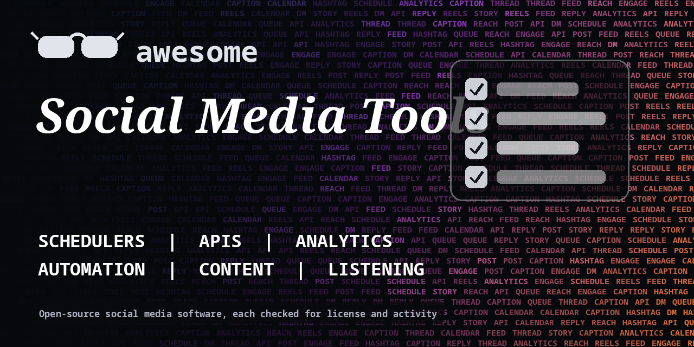

<h1 align="center">Awesome Social Media Tools</h1>

> Open-source schedulers, automation libraries, analytics and content tools for managing social media accounts. Every entry shows its license.

**Rules of this list:** every repo exists, is public, is not archived, states a license and has had a commit in the last year. One plain sentence each. Star counts and claims are the authors' own, we did not test every tool. Checked 2026-10-18. See [CONTRIBUTING.md](CONTRIBUTING.md).

## Contents

- [Schedulers and publishing](#schedulers-and-publishing)
- [API clients and SDKs](#api-clients-and-sdks)
- [Automation and bots](#automation-and-bots)
- [Public data and listening](#public-data-and-listening)
- [Analytics and dashboards](#analytics-and-dashboards)
- [Content and captions](#content-and-captions)
- [Open social networks](#open-social-networks)
- [Downloaders and archivers](#downloaders-and-archivers)
- [How to choose](#how-to-choose)
- [Contributing](#contributing)

## Schedulers and publishing

Plan and publish posts to many networks.

- [brightbeanxyz/brightbean-studio](https://github.com/brightbeanxyz/brightbean-studio)  - Self-hostable platform for scheduling and managing posts across networks. _(AGPL-3.0)_
- [cogsend/cogsend](https://github.com/cogsend/cogsend)  - Self-hosted scheduler that publishes one post to several connected accounts. _(MIT)_
- [getopenpost/openpost](https://github.com/getopenpost/openpost)  - Create, adapt, schedule and track social posts. Self-hostable. _(AGPL-3.0)_
- [gitroomhq/postiz-app](https://github.com/gitroomhq/postiz-app)  - Self-hostable social media scheduler with AI helpers and many network integrations. _(AGPL-3.0)_
- [inovector/mixpost](https://github.com/inovector/mixpost)  - Self-hosted social media management software for Laravel. _(MIT)_

## API clients and SDKs

Libraries for talking to each network.

- [bluesky-social/atproto](https://github.com/bluesky-social/atproto)  - Reference implementation and libraries for the AT Protocol behind Bluesky. _(check repo)_
- [davidteather/TikTok-Api](https://github.com/davidteather/TikTok-Api)  - Unofficial Python wrapper for TikTok. Can break when TikTok changes. _(MIT)_
- [facebook/facebook-python-business-sdk](https://github.com/facebook/facebook-python-business-sdk)  - Official Python SDK for Meta's Marketing API. _(check repo)_
- [halcy/Mastodon.py](https://github.com/halcy/Mastodon.py)  - Python wrapper for the Mastodon API. _(MIT)_
- [isaackogan/TikTokLive](https://github.com/isaackogan/TikTokLive)  - Unofficial Python library to read TikTok LIVE streams. _(AGPL-3.0)_
- [MarshalX/atproto](https://github.com/MarshalX/atproto)  - Python SDK for the AT Protocol and Bluesky. _(MIT)_
- [neet/masto.js](https://github.com/neet/masto.js)  - Mastodon API client for JavaScript and TypeScript. _(MIT)_
- [praw-dev/praw](https://github.com/praw-dev/praw)  - Python wrapper for the Reddit API. _(BSD-2-Clause)_
- [python-telegram-bot/python-telegram-bot](https://github.com/python-telegram-bot/python-telegram-bot)  - Python wrapper for the Telegram Bot API. _(GPL-3.0)_
- [Rapptz/discord.py](https://github.com/Rapptz/discord.py)  - Python API wrapper for Discord. _(MIT)_
- [subzeroid/instagrapi](https://github.com/subzeroid/instagrapi)  - Python library for Instagram's private API. Unofficial, can break and may break Instagram's rules. _(check repo)_
- [tweepy/tweepy](https://github.com/tweepy/tweepy)  - Python library for the X (Twitter) API. _(MIT)_

## Automation and bots

Bots and agents that post, reply or reshare. Check each network's rules before you use them.

- [activepieces/activepieces](https://github.com/activepieces/activepieces)  - No-code automation with social media and AI pieces. _(check repo)_
- [huginn/huginn](https://github.com/huginn/huginn)  - Build agents that watch the web and act for you, including posting and alerts. _(MIT)_
- [n8n-io/n8n](https://github.com/n8n-io/n8n)  - Workflow automation with many social network nodes. Fair-code license, check terms. _(check repo)_

## Public data and listening

Collect public posts, trends and profiles for research.

- [instaloader/instaloader](https://github.com/instaloader/instaloader)  - Download public Instagram photos, videos and metadata. Check Instagram's terms. _(MIT)_
- [vladkens/twscrape](https://github.com/vladkens/twscrape)  - Python tool to read public X data. Unofficial, check X's terms. _(MIT)_

## Analytics and dashboards

Track reach, growth and engagement.

- [grafana/grafana](https://github.com/grafana/grafana)  - Dashboards for metrics and logs. Pair it with social and ad data you already collect. _(AGPL-3.0)_
- [matomo-org/matomo](https://github.com/matomo-org/matomo)  - Full web analytics platform you can self-host. _(GPL-3.0)_
- [plausible/analytics](https://github.com/plausible/analytics)  - Simple, privacy-friendly web analytics you can self-host. AGPL. _(AGPL-3.0)_
- [PostHog/posthog](https://github.com/PostHog/posthog)  - Product analytics, session replay and feature flags. _(check repo)_
- [umami-software/umami](https://github.com/umami-software/umami)  - Privacy-focused web analytics, a simple alternative to Google Analytics. _(MIT)_

## Content and captions

Tools that help write, design and repurpose posts.

- [AUTOMATIC1111/stable-diffusion-webui](https://github.com/AUTOMATIC1111/stable-diffusion-webui)  - Web interface for Stable Diffusion image generation. _(AGPL-3.0)_
- [Comfy-Org/ComfyUI](https://github.com/Comfy-Org/ComfyUI)  - Node-based interface for image, video and audio generation models. _(GPL-3.0)_
- [lllyasviel/Fooocus](https://github.com/lllyasviel/Fooocus)  - Simple image generation tool built on Stable Diffusion XL. _(GPL-3.0)_
- [ollama/ollama](https://github.com/ollama/ollama)  - Run large language models locally to draft captions and post ideas. _(MIT)_

## Open social networks

Self-hostable networks and clients you can run yourself.

- [bluesky-social/social-app](https://github.com/bluesky-social/social-app)  - The Bluesky app for web, iOS and Android. _(MIT)_
- [Chocobozzz/PeerTube](https://github.com/Chocobozzz/PeerTube)  - Federated video platform you can self-host. _(AGPL-3.0)_
- [LemmyNet/lemmy](https://github.com/LemmyNet/lemmy)  - Federated link aggregator and forum, a Reddit-style network you can host. _(AGPL-3.0)_
- [mastodon/mastodon](https://github.com/mastodon/mastodon)  - Self-hosted microblogging network that federates with others. _(AGPL-3.0)_
- [misskey-dev/misskey](https://github.com/misskey-dev/misskey)  - Federated microblogging platform with many features. _(AGPL-3.0)_
- [owncast/owncast](https://github.com/owncast/owncast)  - Self-hosted live streaming and chat server. _(MIT)_
- [pixelfed/pixelfed](https://github.com/pixelfed/pixelfed)  - Federated photo sharing platform, an Instagram-style network. _(AGPL-3.0)_
- [writefreely/writefreely](https://github.com/writefreely/writefreely)  - Markdown-based publishing platform that federates over ActivityPub. _(AGPL-3.0)_

## Downloaders and archivers

Save your own media and posts.

- [mikf/gallery-dl](https://github.com/mikf/gallery-dl)  - Command-line tool to download image galleries and collections from many sites. _(GPL-2.0)_
- [yt-dlp/yt-dlp](https://github.com/yt-dlp/yt-dlp)  - Command-line downloader for video and audio from many sites. _(Unlicense)_

## How to choose

- **Read each network's terms.** Automation that breaks them can get an account banned.
- **Use official APIs first.** Scrapers and unofficial clients break often.
- **Do not buy followers or fake engagement.** Tools here are for planning and analysis.
- **Check the last commit.** Social APIs change often and old clients stop working.

## Contributing

See [CONTRIBUTING.md](CONTRIBUTING.md). One entry per pull request, plain words, real sources only.

## About

Maintained by [@devanasolver](https://github.com/devanasolver). Listings follow the rules in CONTRIBUTING.

## Sponsor me

If this list is useful, [buy me a coffee](https://buymeacoffee.com/isaac49).
